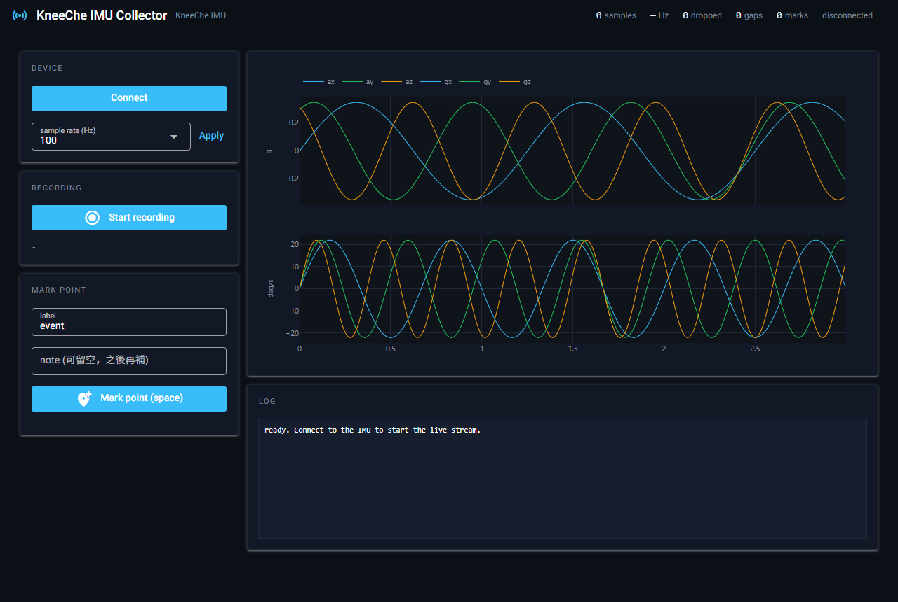

# KneeChe — BMI270 IMU Collector (XIAO nRF54L15)

以 Seeed Studio XIAO nRF54L15 讀取 Bosch BMI270 六軸 IMU，透過 **BLE** 即時串流，
附一個給實驗室資料採集用的桌面板（採樣率設定、錄製、標記點、ML 友善輸出）。

---

## 功能

- 6 軸 IMU（加速度 ±8 g、角速度 ±500 dps），採樣率 25 / 50 / 100 / 200 / 400 Hz 執行中可切換
- data-ready 中斷驅動取樣，不重複取值
- BLE 二進位串流，每筆樣本自帶裝置時間戳
- 連線即時串流（預覽），按錄製才寫檔
- 標記點可事後編輯 / 刪除備注
- 輸出 CSV + JSONL + meta.json，可直接進 pandas

---

## 硬體

| BMI270 | XIAO nRF54L15 | 說明 |
|---|---|---|
| SDA | **D4** (P1.10) | 硬體 I2C（`i2c22`） |
| SCL | **D5** (P1.11) | 硬體 I2C（`i2c22`） |
| INT1 | **D1** (P1.05) | data-ready 中斷，上升緣 |
| VDD | 3V3 | 不可接 5V |
| GND | GND | |
| SDO | GND | 位址 `0x68`；接 3V3 則為 `0x69` |

**INT 只能接 GPIO0 或 GPIO1 的腳位**（D0–D5、D11、D12）。D6–D10 與 D13–D15 屬於 GPIO2，
這顆 SoC 的 GPIO2 沒有綁 GPIOTE，無法配置邊緣中斷。不接 INT 也能運作，程式會自動退回
計時器輪詢，只是時間戳抖動較大。

I2C 上拉通常由感測器模組提供（4.7 kΩ）。**不要並聯太多顆** —— 會讓上升緣變慢，高採樣率下出錯。

---

## 需求

**韌體**
- nRF Connect SDK（測試於 NCS v3.3.0 / Zephyr 4.3.99）與對應 toolchain
- 板子定義 `xiao_nrf54l15` 需存在於 Zephyr（`zephyr/boards/seeed/xiao_nrf54l15`）
- Usb-C 傳輸線即可，**不需要外部除錯探針**：板上的 SAMD11 同時是 USB↔SWD 橋與序列埠橋

**主機端面板**
- Python 3.10+（測試於 3.14.7）
- BLE 介面（筆電內建或 USB dongle）
- `pip install -r tools/requirements-lock.txt`

---

## 建置與燒錄

標準 west 流程：

```bash
# 在 NCS workspace 內
west build -p always --no-sysbuild \
    -b xiao_nrf54l15/nrf54l15/cpuapp \
    -d build .

west flash -d build
```

`--no-sysbuild` 是刻意的：這個應用沒有 MCUboot / TF-M，不需要多映像建置。

> repo 內另附 `build.ps1` / `flash.ps1`（Windows 便利腳本）。它們把 NCS toolchain 路徑寫在
> 檔案開頭，換環境時請自行改成自己的安裝位置，或直接使用上面的 west 指令。

### 序列埠

燒錄後會出現一個 CDC ACM 序列埠（SAMD11 橋接的 UART，115200 baud）。
用來下指令與看診斷訊息；資料本身走 BLE，不佔用這個埠。

---

## 序列埠指令

每條指令以換行結尾，亦可透過 BLE 的 RX 特徵寫入（同樣格式）。

| 指令 | 作用 |
|---|---|
| `S,<hz>` | 設定採樣率，1–1600 Hz，即時生效 |
| `START` / `STOP` | 開始 / 停止串流（連線時會自動開始，通常不需要手動下） |
| `?` | 印出目前設定與狀態 |
| `I` | 讀出 chip id / internal status / ACC_CONF / GYR_CONF / PWR_CTRL |
| `C` | 掃描 I2C 匯流排 0x08–0x77 |
| `R` | 重新初始化感測器 |
| `L` | 開關序列埠 CSV 輸出（除錯用） |

感測器未初始化時 `S` 會被拒絕並提示，不會假裝成功。

---

## BLE 介面

使用 Nordic UART Service 的 UUID，方便通用工具（nRF Connect、bleak）直接找到：

| 用途 | UUID |
|---|---|
| Service | `6e400001-b5a3-f393-e0a9-e50e24dcca9e` |
| RX（寫入指令） | `6e400002-b5a3-f393-e0a9-e50e24dcca9e` |
| TX（notify 資料） | `6e400003-b5a3-f393-e0a9-e50e24dcca9e` |

**Frame 格式**（little-endian）：

```
[type u8][seq u16][dropped u16][n u8][sample × n]

type = 0x01  樣本批次
sample = [t_us u32][ax i16][ay i16][az i16][gx i16][gy i16][gz i16]   // 16 bytes
```

- 傳輸的是**原始 LSB 值**，單位換算留給主機，裝置端不做任何四捨五入
- `t_us` 是裝置開機以來的微秒數 —— 時間軸不受 BLE 連線事件抖動影響
- `dropped` 是裝置端環形緩衝區溢出的累計數；`seq` 不連續代表 frame 遺失
- MTU 247 時每包可裝 14 筆；裝置會依協商出的 MTU 自動調整並批次打包

參考實作：`tools/collector/protocol.py`（解碼）與 `tools/ble_probe.py`（純協定層驗證）。

---

## 採樣率的兩層設計

**感測器 ODR** 自動挑「不小於要求速率」的檔位：
≤25→25、≤50→50、≤100→100、≤200→200、≤400→400、≤800→800、其餘→1600 Hz。

**實際輸出速率** 由微秒級節流器限制在指定值，所以 `S,30` 得到 30 Hz（ODR 50 Hz 的多餘樣本會被丟棄），
不是 50 Hz，也不會重複輸出同一筆。

**INT 的角色**：只在收到 data-ready 邊緣後才讀資料，確保每筆都是新樣本；1 秒內若完全沒有邊緣，
自動退回計時器輪詢並印一次警告。

---

## 採集面板



```bash
python tools/app.py          # 原生視窗（WebView2）
python tools/app.py --web    # 服務於 http://127.0.0.1:8080，用瀏覽器開
python tools/app.py --demo   # 介面預覽，圖表顯示合成波形，不連裝置
python tools/app.py --auto   # 自動連線→錄製→打點，展示用
```

不需要 Node.js，也不連任何 CDN（前端資源全部內附），可在離線環境運作。

### 頂欄數字

| 欄位 | 意義 |
|---|---|
| `samples` | 連線以來收到的樣本數（不錄製也累計） |
| `Hz` | 最近 2 秒的瞬時採樣率；偏離設定值 >10% 轉琥珀色，無資料時顯示 `—` |
| `dropped` | 裝置端環形緩衝區溢出數（裝置回報） |
| `gaps` | frame 序號不連續次數 |
| `marks` | 目前 session 的標記點數 |

累積平均不放在頂欄（對即時狀況不敏感），寫在 `meta.json` 的 `samples / duration_s`。

### 操作流程

```
Connect            → 立刻看到即時波形與速率（尚未寫檔）
選速率 → Apply      → 裝置即時切換 ODR
Start recording    → 開始寫 imu.csv
Mark point（空白鍵）→ 記錄標記點與備注
Stop               → 關檔並產生 meta.json
```

標記點在錄製結束後仍可於表格中雙擊編輯備注、按 `Del` 刪除 —— `marks.jsonl` 每次都從記憶體整份重寫。

---

## 輸出格式

每次錄製建立一個 `sessions/session_YYYYmmdd_HHMMSS/` 目錄：

```
imu.csv      t_dev_us,t_host_ns,ax_mg,ay_mg,az_mg,gx_mdps,gy_mdps,gz_mdps
marks.jsonl  {"t_dev_us":…,"t_host_ns":…,"t_wall":…,"label":…,"note":…,"sample_index":…}
meta.json    裝置、速率、樣本數、丟包數、序號跳號、量程、時長
```

- `t_dev_us` 裝置時間（微秒），`t_host_ns` 主機收到時的 wall-clock（奈秒）
- 加速度 **mg**、角速度 **mdps**（千分之一單位，整數運算，無浮點誤差累積）
- `marks.jsonl` 的 `sample_index` 可直接對應 `imu.csv` 的行，方便切分窗口

pandas 讀取：

```python
import pandas as pd
imu = pd.read_csv("sessions/session_.../imu.csv")
marks = pd.read_json("sessions/session_.../marks.jsonl", lines=True)
```

---

## 專案結構

```
.
├── CMakeLists.txt / prj.conf / app.overlay   韌體建置設定
├── build.ps1 / flash.ps1                     Windows 便利腳本
├── src/
│   ├── main.c                                取樣、中斷、指令、速率控制
│   ├── bmi270.c/.h                           驅動：初始化序列、ODR、讀值、掃描
│   ├── bmi270_config_file.h                  BMI270 的 8 KB 初始化 blob
│   └── ble_stream.c/.h                       BLE 服務、環形緩衝、批次打包
└── tools/
    ├── app.py                                NiceGUI 採集面板
    ├── collector/                            與 UI 無關的核心（可獨立測試）
    │   ├── protocol.py                       框架解碼與單位換算
    │   ├── recorder.py                       CSV / marks.jsonl / meta.json
    │   ├── ble.py                            bleak + asyncio 背景執行緒
    │   └── session.py                        狀態機：連線、錄製、打點、pump
    ├── collector_ui.py                       舊的 Tkinter 版（保留作對照）
    ├── ble_probe.py / scan.py                協定驗證與裝置掃描
    └── _e2e_core.py 等                       測試腳本
```

核心與 UI 分離的好處：`python tools/_e2e_core.py` 可在不開視窗的情況下驗證整條資料路徑。

---

## 實作備註

### BMI270 需要 8 KB 初始化 blob

BMI270 上電後是空白的，必須把 `bmi270_config_file.h` 的內容寫進 `INIT_DATA` 才會開始量測。
沒有它，chip id 讀得到但資料永遠是 0。這份 blob 取自 Bosch 官方 `BMI270_SensorAPI`
（BSD-3-Clause），逐位元組抽出，不要手改。

### nRF TWIM 的 EasyDMA 讀不到 flash

把 config blob 直接從 `static const`（位於 flash）burst write 出去會失敗（`-ENOSPC`）。
必須先複製到 RAM 再寫 —— 見 `src/bmi270.c` 的 `write_block()`。

### 兩個容易漏掉的 Kconfig

`prj.conf` 裡這兩行是必要的，移除後建置或連結會失敗：

```conf
# 某些 Zephyr revision 在 nRF54L15 上宣告帶參數的共享中斷，
# 沒有軟體 ISR 表時 gen_isr_tables.py 會報錯：
#   "Regular Interrupt N declared with parameter … but no SW ISR_TABLE"
CONFIG_GEN_SW_ISR_TABLE=y

# 這塊板子預設為單執行緒，會把 k_sem 整個編掉
# （連結時 z_impl_k_sem_take / give / reset 未定義）
CONFIG_MULTITHREADING=y
```

換成其他 Zephyr 版本時，若症狀消失可再評估是否保留。

### INT 腳位用手動 gpio_dt_spec

`main.c` 的 `imu_int` 是手工組出的 `struct gpio_dt_spec`，不是 `GPIO_DT_SPEC_GET`。
原因：沒有 `compatible` 的 devicetree 節點不會產生 phandle-array 的 GPIO 巨集。
若想改用 DT，節點需掛在有 binding 的 `compatible` 底下（例如 `gpio-keys`）。

---

## 疑難排解

| 訊息 / 現象 | 處理 |
|---|---|
| `# ERR: I2C read failed` | 完全沒回應。量 3V3/GND，確認 SDA/SCL 未接反、上拉存在 |
| `# ERR: chip id 0x00` | 匯流排通了但讀到 0x00 —— SDA 被拉低或晶片未上電 |
| `# ERR: chip id 0xFF` | 讀到浮空 —— SDA 沒接上 |
| `# ERR: chip id 0xXX` | 位址對了但不是 BMI270，或 SDO 接法不同（試 `0x69`） |
| `# ERR: config load failed` | 8 KB 初始化失敗，多為供電不穩；把 `app.overlay` 的 `clock-frequency` 降到 `100000` 重試 |
| `# WARN: no INT edge` | INT 未接或不是 INT1；程式已自動退回輪詢 |
| 面板找不到裝置 | 確認裝置已上電、未被其他程式連線；用 `python tools/scan.py` 檢查是否在廣播 |
| 面板顯示舊版畫面 | 可能有殘留的舊實例佔用埠號；程式會自動改用下一個埠並在啟動時提示 |

---

## 授權與致謝

- BMI270 初始化 blob 與暫存器定義來自 [Bosch Sensortec BMI270_SensorAPI](https://github.com/boschsensortec/BMI270_SensorAPI)（BSD-3-Clause）
- BLE 使用 Nordic UART Service 的 UUID 慣例
